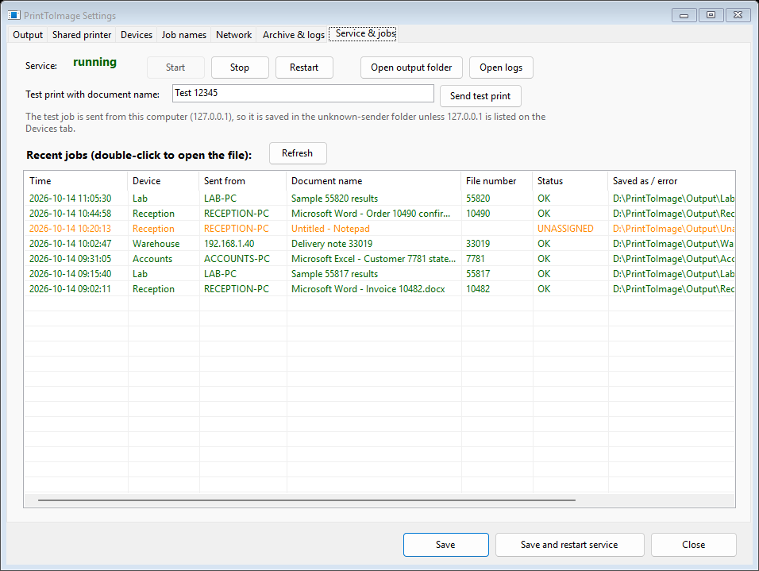
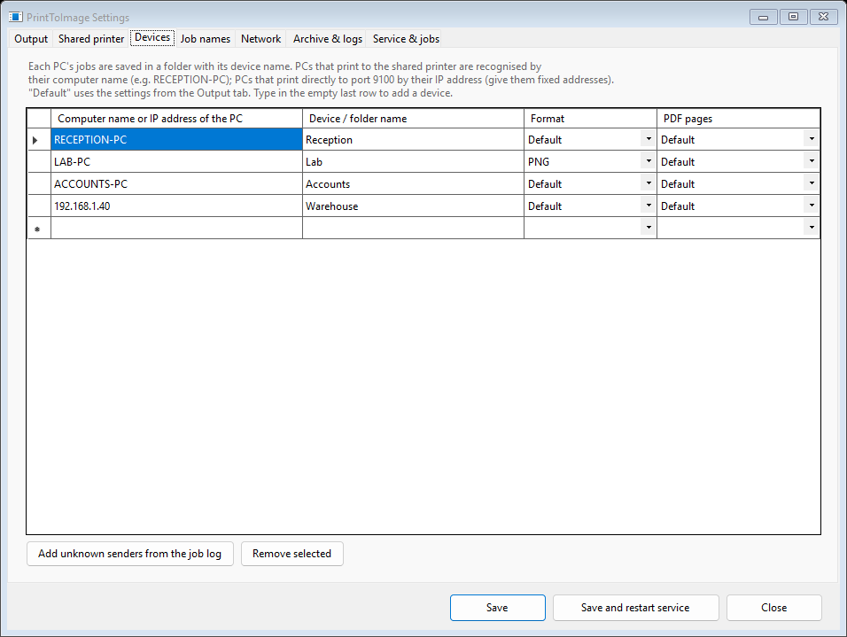
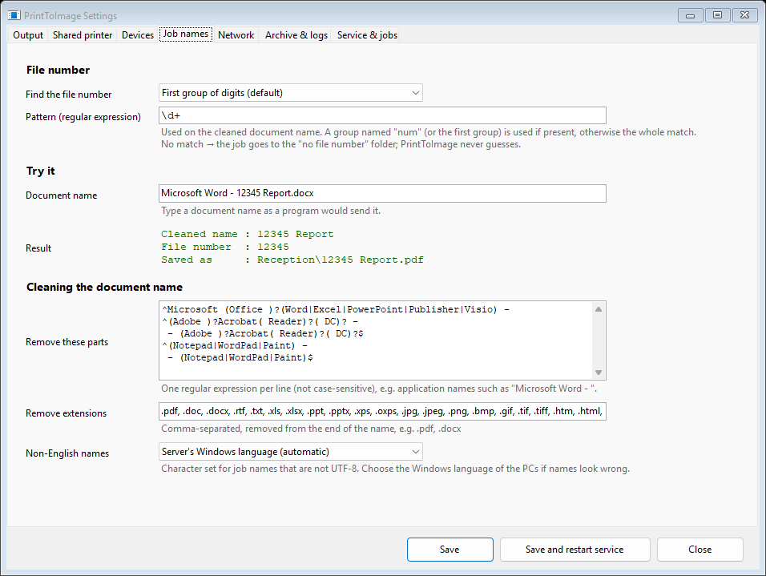

# PrintToImage

**A network printer that saves every print as a file.** Install it once on a Windows server, and every PC in the office
can print to it. Each print job becomes a **PDF, JPG or PNG** file, named after the document and sorted into folders,
with nothing to click.

No Ghostscript. No software on the client PCs. No "Save as" dialog.



## How it works

```
 Any PC  ──print──►  \\SERVER\PrintToImage  ──►  D:\PrintToImage\Output\Reception\Invoice 10482.pdf
                                                 D:\PrintToImage\Output\Lab\Sample 55817 results.png
```

1. Install PrintToImage on a server, or on any PC that is always on. It creates a shared printer, `\\SERVER\PrintToImage`.
2. Add that printer on the other PCs, the same way you add any shared office printer.
3. Print from any program. The file appears in the output folder, in a subfolder for the PC that printed it, named after
   the document (for example `Invoice 10482.pdf`).

## Why PrintToImage

- **One printer for the whole network.** Install it once on the server, with nothing to install or update on each PC.
- **Fully automatic.** Nobody types a file name or picks a folder. Files are named after the document, and sorted by
  the PC that printed them.
- **Finds numbers in document names, or on the page.** It can pull an invoice, order, case or patient number out of
  the document name, or out of the text printed on the page (for devices that name every print after the report),
  and send anything without a number to a "check by hand" folder. It never guesses.
- **PDF, JPG or PNG.** Real PDFs with sharp, searchable text, or images at the resolution you choose. You can set
  this per PC.
- **No Ghostscript.** PrintToImage has its own PostScript engine. There's nothing extra to install, and no AGPL
  license terms to worry about.
- **Made for unattended use.** It runs as a Windows service and starts with Windows. A file appears only once it is
  complete. While the service is stopped, jobs wait in the print queue, and every job is archived for 30 days.
- **Easy to manage.** A settings app covers folders, formats, PCs and naming rules, and shows a live job list.

## Compared with the alternatives

| | PrintToImage | Microsoft Print to PDF | Ghostscript |
|---|:---:|:---:|:---:|
| Shared on the network: one install for every PC | ✅ | ❌ (each PC saves for itself) | ❌ (a converter, not a printer) |
| Saves automatically, no "Save as" dialog | ✅ | ❌ | — |
| Names and sorts files (by document, number, PC) | ✅ | ❌ | ❌ |
| PDF, JPG and PNG | ✅ | PDF only | ✅ |
| Settings app and job list | ✅ | ❌ | ❌ |
| License for business use | low, one-time price per server | included with Windows | AGPL, or a paid license from Artifex |

## Who it's for

- **Offices:** keep a PDF of every invoice, order and delivery note that any program prints, filed by number.
- **Clinics and labs:** save reports from devices and instruments straight into the right folder for your EMR or LIMS.
- **Old software that can only print:** capture its output as PDFs for your archive or document system, with no
  changes to the program.
- **Paperless offices:** replace "print, then scan" with "print to PrintToImage".

## Get started

1. Download `PrintToImage-<version>-win-x64.zip` from the
   [Releases page](https://github.com/baheras1993/PrintToImage/releases/latest) and extract it on the server.
2. Double-click **Install PrintToImage.bat** and answer three questions.
3. On each PC, add the printer `\\SERVER\PrintToImage` and print to it.

**Requirements:** Windows 10/11 or Windows Server 2016 or newer, 64-bit. Nothing else is needed; .NET is built in.
Client PCs with Windows 7 to 11 connect to the shared printer. Older PCs and other devices can print directly to
port 9100 (or LPR) with a PostScript driver.

The full guide is in **[docs/MANUAL.md](docs/MANUAL.md)**, also included in the download as `README.txt`. It covers
settings, connecting PCs, troubleshooting and uninstalling.

<p>
  
  
</p>

## License and price

- **Free** for personal use, charities, schools and universities, public hospitals and health organisations, and
  government offices.
- **Businesses** need a commercial license: a **low, one-time price per server**, covering every PC that prints to
  it. You can try it free for 30 days first.

See **[COMMERCIAL.md](COMMERCIAL.md)** for the details. The license text is in [LICENSE](LICENSE)
(PolyForm Noncommercial 1.0.0).

## For developers

PrintToImage is written in C# (.NET 8). It uses its own PostScript Level 3 interpreter, and SkiaSharp for drawing
and PDF output. To build it, run the tests and create the installable package in `dist\PrintToImage`:

```powershell
powershell -ExecutionPolicy Bypass -File .\build.ps1
```

| Folder | Contents |
|---|---|
| `src/PrintToImage` | the Windows service; `PostScript/` is the interpreter (fonts, graphics, PDF/JPG/PNG output) |
| `src/PrintToImageSettings` | the settings app (Windows Forms) |
| `src/SendTestPrint` | a command-line tool that sends test print jobs |
| `tests/PrintToImage.Tests` | xUnit tests; `Fixtures/` holds real print jobs from Windows drivers |
| `scripts` | what goes into the package: the `.bat` files, the install and uninstall scripts, default settings |
| `tools` | build helpers (the manual as `README.txt`, third-party notices) |
| `docs` | the manual and screenshots |
